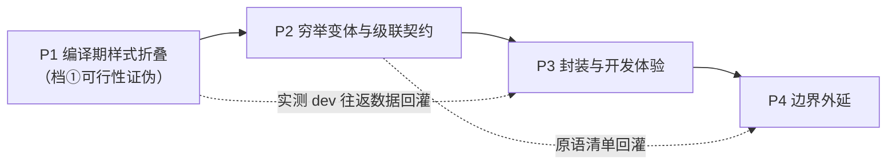

# Kairos 阶段表

> 层级：圣杯
> 上游：../../direction.md
> 对话记录：phases.dialogue.md
> 生成日期：2026-10-29

## 1. 阶段总览

| 阶段 | 核心目的 | 一句话目标 | 前序依赖 | 主要风险 |
|---|---|---|---|---|
| [P1 · 编译期样式折叠](#p1--编译期样式折叠档可行性证伪) | 证明"enum 模式轴 + 原语 → 编译期静态产物"这条链在真实 Kotlin/JS 工具链上跑得通；不通则后续全部失去意义 | 一个 enum + 一个原语，走到可打开的静态页面，样式 100% 来自编译期产物 | 无 | K2 插件面不稳定；IR 形状与预期不符；Kotlin/JS 构建链路耦合 webpack |
| [P2 · 穷举变体与级联契约](#p2--穷举变体与级联契约) | 把"可穷举"从"能折叠一个样式块"变成"多轴多分支在一条确定的优先级代数下成立"，否则招牌能力没有兑现 | 枚举轴驱动的变体原语 + `@layer` 类别全序 + 穷尽覆盖诊断 | P1 | 优先级代数设计错误会连锁到 P3/P4；原语集合膨胀（H11） |
| [P3 · 封装与开发体验](#p3--封装与开发体验) | 让底层约束不落到作者手上，并让开发期往返可接受；否则"第二个项目"不会发生 | 上层零残留封装、开发期延迟达标、按需反查可用 | P2 | 开发期延迟可能无法靠"绕过 Kotlin 编译"解决；HMR 形态未定 |
| [P4 · 边界外延](#p4--边界外延) | 在自用第二个项目之前补齐真正缺的边界，否则 P1–P3 只是玩具 | 跨模块样式聚合与剪枝 + 必要生态件 | P3 | 范围膨胀，阶段失去终点 |

## 2. 阶段依赖图

四个阶段**严格串行**：每一阶段的核心验收标准都是下一阶段的技术前提。虚线是数据回灌，不是依赖。

## 3. 分阶段详述

### P1 · 编译期样式折叠（档①可行性证伪）

| 项 | 说明 |
|---|---|
| **核心目的** | 方向文档里的整套论证（enum 封闭性 → 变体穷举 → 样式上提为类）目前**只有推理，没有一次真实的编译器往返**。P1 要在真实 Kotlin/JS 工具链上把这条链跑通一次：如果一个 `enum` 模式轴 + 一个样式原语能被编译器折叠成静态类名与静态 CSS，后面的阶段才值得排；如果跑不通，要在这一阶段就把方向改掉，而不是等到 P3 才发现。 |
| 目标 | 一个 `enum` 模式轴 + 一个样式原语 → 编译期产出的 CSS 与类名 → 一个能在浏览器打开的静态页面；页面样式 100% 来自编译期产物，运行时不做样式计算。 |
| 技术路线 | 编译器插件挂在 IR 生成阶段，读取样式原语 lambda 体内的常量声明，把整块折叠成字符串常量；原子类名由声明内容的确定性哈希得到；插件在编译期写出 CSS 与 sidecar 映射；构建期装配出静态产物目录。 |
| **核心验收标准** | ① **档①成立**：产物 JS 中不存在样式原语的运行时调用（静态扫描产物为证），且页面样式全部来自编译期写出的 CSS 文件。 ② **产物确定性**：清空输出目录后连续两次构建，CSS 与映射文件逐字节一致。 ③ **降级不骗人**：故意写一个不可折叠的样式块（捕获运行时值），其行为与折叠版一致、类名相同，只有"归属在编译期还是运行时"不同。 |
| 前序依赖 | 无。本阶段自成闭环，失败也能独立判定。 |
| 主要风险 | ① K2 编译器插件面在两个大版本之间破坏性变更频繁，锁定版本后不宜频繁升级；② IR 中 lambda 体的实际形状可能与预期不符（**已部分证伪**：侦察实验已观察到 `css{}` 调用与 lambda 体内的 `declaration(...)` 调用同时出现在 IR 中）；③ Kotlin/JS 默认构建链与 webpack/npm 耦合，静态产物装配需要绕开它。 |

### P2 · 穷举变体与级联契约

| 项 | 说明 |
|---|---|
| **核心目的** | P1 只证明"一个样式块能被折叠"。这是任何 CSS-in-JS 静态抽取器都能做到的事，**不构成身份**。P2 要兑现身份：让枚举轴的**全集在编译期可见**，由它驱动变体生成；并让 `base + variant + override` 这类组合在一条**确定的优先级代数**下成立。不做这一步，Kairos 与 vanilla-extract 的差别就只剩实现语言。 |
| 目标 | 枚举轴驱动的样式变体原语（N 分支）；base/variant/override 组合的级联语义落地；漏写某个枚举常量的变体时编译期能诊断出来。 |
| 技术路线 | 沿用"常量上提为类、条件退化为类名选择"的原语语义：2 分支与 N 分支是同一条机制的两种入口。级联采用**两段式**（见 §4 的 Q9 归属）：类别之间的全序由 `@layer` 固定，同一类别内同属性冲突由编译期消解。枚举轴的全集从 `enum` 常量表在编译期直接读取，不依赖反射。 |
| **核心验收标准** | ① **级联语义可证**：一组冲突组合用例（同属性、伪类、媒体查询、第三方样式表四类各至少一例），编译期解析结果与文档语义的全序完全一致。 ② **穷尽覆盖可诊断**：故意漏掉一个枚举常量的变体映射时，编译期给出带准确位置的诊断（至少一次真实排障）。 ③ **组合零运行时**：任意静态组合产出的 class 列表都是编译期常量，产物中无拼接代码。 |
| 前序依赖 | P1 的折叠机制与产物格式。 |
| 主要风险 | ① 优先级代数是连锁错误源——它一旦错了，P3 的封装与 P4 的剪枝都会建在错误语义上；② 原语集合膨胀（H11）：每多一个原语就多一条长期兼容承诺。 |

### P3 · 封装与开发体验

| 项 | 说明 |
|---|---|
| **核心目的** | 方向文档的代价①写得明白：建模成本落在作者身上。如果底层约束没有零残留的上层封装兜住，作者在第二、第三个项目里就会图省事绕开约束——这是方向文档风险③，也是这条路线最真实的死法。同时，开发期每次样式改动都要过一遍 Kotlin 编译，若延迟不可接受，DX 会先死在这里（D11 记为 P0）。 |
| 目标 | 上层封装写法在产物中仍然折叠为常量（零残留）；开发期往返延迟落到自定预算内；能从一个产物类名反查回源码位置。 |
| 技术路线 | 先实测 P1/P2 的真实开发期往返，用数据决定是否需要让样式改动绕过 Kotlin 编译；封装形态限定为"本身就是原语"或"能展开成原语认识形态"（`inline`、值类、可展开调用）；可反查基于编译期写出的 sidecar 映射。 |
| **核心验收标准** | ① **零残留可证**：三种封装写法（`inline` 函数、值类、扩展函数）各至少一例，产物中均折叠为常量。 ② **开发期往返**：一次样式改动的端到端往返落在本阶段用实测数据定下的预算内。 ③ **可反查**：给定产物中任一原子类名，能定位回源码文件与行（至少一次真实排障）。 |
| 前序依赖 | P2 的原语语义与产物格式。 |
| 主要风险 | ① "绕过 Kotlin 编译"在 Kotlin/JS 上可能没有干净入口；② 值类 / `inline` 在 IR 中的展开时机若在插件之后，零残留会静默失效（契约 3 要求此时必须只是降级、不是行为差异）。 |

### P4 · 边界外延

| 项 | 说明 |
|---|---|
| **核心目的** | P1–P3 把"单模块自用"做完。但方向文档验证信号 5 是"用 Kairos 写出第二个自己的项目，且不改框架源码"——第二个项目一定会跨模块、一定会引入外部样式。没有跨模块聚合与剪枝，这个信号永远拿不到。 |
| 目标 | 跨模块样式聚合与剪枝落地；补齐自用中真正缺的生态件（反查 CLI / devtools 提示）。 |
| 技术路线 | 构建期收集各模块的 sidecar 映射再统一聚合；剪枝以可达性为依据，剪枝失败时宁可多留（样式缺失是真问题，字节浪费是温和问题）。 |
| **核心验收标准** | ① **跨模块闭环**：两个模块各自声明样式，最终 CSS 无重复、无遗漏，未被引用的样式被剪掉。 ② **自用验证**：用它写出第二个项目，且过程中不需要改动框架源码。 |
| 前序依赖 | P3 的产物格式与反查能力。 |
| 主要风险 | ① 范围膨胀——"生态件"没有自然终点，必须由"自用中真正缺的"来裁剪；② 剪枝改成跨模块后会与 P2 的层顺序交互。 |

## 4. 待决问题归属

| 问题 | 归属 | 依据 |
|---|---|---|
| Q9 级联优先级代数 | **已落地（P2）** | 本层定下**两段式**：类别之间用 `@layer` 建立全序，同一类别内同属性冲突由编译期消解；两条都不成立时才退回"性能与安全 > 样板"（D21）。理由：纯编译期消解处理不了运行时才知道的组合，纯 `@layer` 又无法消除同层冗余；两段式让两者各管一段。P2 负责把全序表写成可测用例。 |
| H11 原语集合的具体清单与规模 | **已部分关闭（P2/P3）** | 实际收敛得比预期小：样式原语只有 @@declaration@@ 一个入口 + 28 个按"名字即属性"解析的 inline helper；变体原语没有独立 API，直接用 Kotlin 自身的 @@if@@ / @@when@@（分支常量上提为类）。剩余开放点：伪类、媒体查询、@@@supports@@ 这类"驼峰无法表达"的场景仍需显式原语。 |
| Q14 渲染模型（构建期渲染 / 运行时建 DOM / IR 解释器） | **P1 已定** | 取"构建期在 JVM 上渲染静态 HTML"：与"HTML 直出"一致、与折叠机制解耦、且不要求插件理解整个 Kotlin 子集（见 [phase-1/round-2.dialogue.md L1](phase-1/round-2.dialogue.md#l1--渲染模型的三条路与为什么选第一条)） |
| 是否引入显式状态转移契约 | P3 或更晚 | 它只影响"不可达状态"诊断，不影响档①成立；P2 的穷尽覆盖诊断不需要它。 |
| 开发期方案的落地方式（样式改动是否绕过 Kotlin 编译、HMR 形态） | **部分交付（P3）** | 已交付：dev 模式类名带源码行、映射带行列号、反查 CLI。未定：样式改动仍需过 Kotlin 编译，往返尚未实测 —— P3 的 A2 核心验收仍缺一条实测数据。 |
| 跨模块样式聚合与剪枝的最终形态 | **已交付可运行形态（P4）** | 按类名去重 + 按产物（HTML/JS）使用集合剪枝，接进构建。未做：死代码树摇、增量聚合；剪枝对运行时拼接的类名无能为力（当前折叠保证类名是字面量）。 |

## 5. 与上游的偏离

| # | 上游结论 | 本层结论 | 理由 | 建议 |
|---|---|---|---|---|
| 1 | 阶段 1 = "从一个 enum 模式 + 一个原语走到静态产物，并在真实小页面里跑起来" | P1 把"静态产物"收窄为**样式侧的静态产物**（编译期写出的 CSS + 类名常量），HTML 直出放到 P1 的渲染轮次里做，但不作为 P1 的核心验收标准 | 把"样式能否被编译器折叠"和"渲染模型长什么样"两个不确定性绑在一起验收，失败了分不清是哪一边的问题。先单独证伪前者。 | 建议维持上游阶段 1 的表述，本层特例：P1 的核心验收只对样式侧负责 |
| 2 | 上游未规定编译器插件的接入方式 | P1 用编译器命令行插件参数手工接线；Gradle 侧的统一插件推到 P3 | P1 的目标是证伪机制，不是开发体验；手工接线能更快暴露 API 层面的真实问题 | 建议同步修订 direction.md 第 8 节，注明"接入体验属 P3" |
| 3 | Q9 要求"到 /ltc 必须定" | 本层给出**两段式**结论（`@layer` 定类别全序 + 编译期消解同层同属性） | 两个备选各自只能覆盖一半场景，两段式是唯一同时成立的组合 | 建议同步修订 direction.md 第 5 节，把 Q9 标为"已在 phases 层收窄" |

## 6. 与上游核心验收的差距（截至 2026-10-29）

四个阶段的功能已实现并有自动验收，但下列**核心验收条目尚未落地**，记录在此以免"全部完成"被误读：

| 阶段 | 条目 | 状态与原因 |
|---|---|---|
| P1 | 产物 JS 的静态扫描证明 | 只有运行期证据（`folds=0`）与字面量断言；未做 AST 级扫描 |
| P2 | 伪类 / 媒体查询 / 第三方样式表四类冲突用例 | 未实现。当前原语只能表达普通属性；`hover`、``media` 需要新的显式原语 |
| P2 | 漏分支的编译期诊断 | 由 Kotlin 自身穷尽检查覆盖，编译器未加额外诊断 |
| P3 | 值类 / 注解式封装 | 仍未实现；P5 只验证了 inline 扩展函数与属性 delegate |
| P3 | 开发期往返实测 | 未测量。样式改动仍需过 Kotlin 编译，P0 指标没有数据 |
| P3 | 源码位置进类名 | **已撤除**：与"JVM 无插件渲染"路径冲突，见 [phase-3 报告补记](phase-3/round-1.report.md#补记审查后撤除-dev-类名2026-10-29) |
| P4 | 用 Kairos 写出第二个项目且不改框架源码 | **已达成（P5）**：`blog` 是一个独立项目（Ktor + SQLite + htmx 后端、Kotlin/JS 前端），全程未改框架源码 |

这些差距不改变"路线被证明可行"的结论（P1 的核心验收已达成），但它们是**下一阶段真正的工作量**。

## 7. P5 之后的现状（2026-10-30）

P5 重构了产物形态与模块划分，上表的部分条目因此发生变化：

- **合并类**取代逐声明原子类：一个样式块 = 一个类，类名由"层 + 排序后的声明组"哈希得到。
- **块内动态值被禁止**：状态变化用 `when` 选择整组样式，档②从"条件值上提"变为"整组选择"。
- **一套核心两个库**：`kairos-core`（含响应式核心与序列化）+ `kairos-browser` / `kairos-htmx`。
- **第二个项目已达成**：博客示例是独立项目，后端与前端都只依赖框架公开 API。
- 仍未达成：伪类/媒体查询/`@supports` 原语、值类封装、开发期往返实测。
